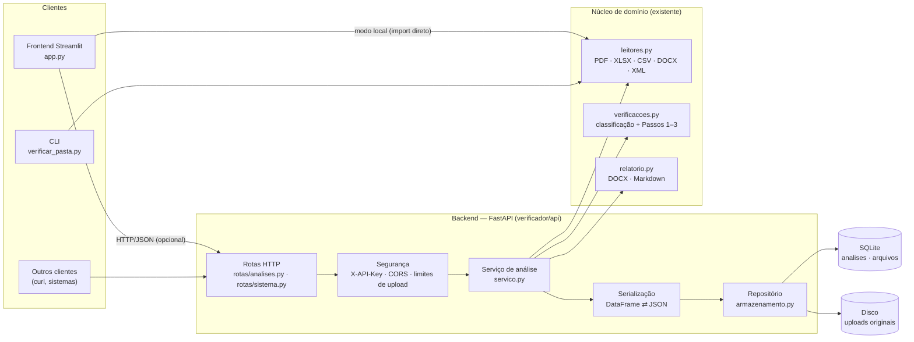
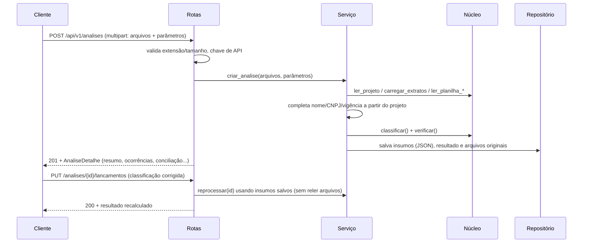
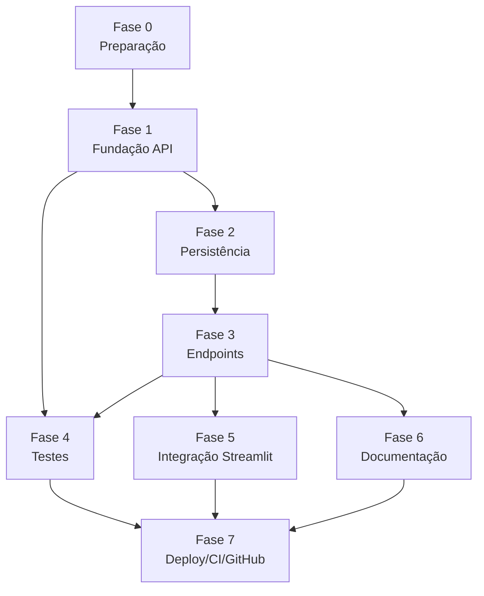

# Plano de Desenvolvimento — Backend do Verificador de Prestação de Contas

> **Status geral:** 🟡 em andamento (60/64) — fases 0–7 concluídas; fases 8–9 (Vercel e apresentação) em andamento · **Última atualização:** 10/11/2026
>
> Marque `[x]` ao concluir cada tarefa. Cada tarefa tem um **critério de verificação** (✔) que diz
> como comprovar que ela está pronta. O progresso de cada fase é atualizado na tabela abaixo.

## Painel de progresso

| Fase | Descrição | Estimativa | Tarefas | Status |
|---|---|---|---|---|
| 0 | Preparação e linha de base | 0,5 dia | 5/5 | ✅ |
| 1 | Fundação da API (FastAPI) | 1 dia | 6/6 | ✅ |
| 2 | Persistência (SQLite + arquivos) | 1 dia | 5/5 | ✅ |
| 3 | Endpoints de análise (fluxo do frontend) | 2 dias | 8/8 | ✅ |
| 4 | Testes automatizados | 1,5 dia | 6/6 | ✅ |
| 5 | Integração com o frontend Streamlit | 1 dia | 4/4 | ✅ |
| 6 | Documentação | 0,5 dia | 5/5 | ✅ |
| 7 | Deploy, CI e GitHub | 1 dia | 6/6 | ✅ |
| 8 | Deploy na Vercel + frontend web + PostgreSQL | 2 dias | 12/14 | 🟡 |
| 9 | Apresentação do trabalho (faculdade) | 0,5 dia | 3/5 | 🟡 |
| **Total** | | **11 dias úteis** (≈ 2,5 semanas, 1 desenvolvedor) | **60/64** | 🟡 |

---

## 0. Análise do repositório (contexto)

**Fontes analisadas**

| Documento | Onde | Conteúdo relevante |
|---|---|---|
| `README.md` (GitHub `pedroparosc/missao`) | remoto | Só o título `# missao`. O repositório remoto estava vazio. |
| `passo_a_passo_prestacao_de_contas.md` | local | **Funciona como Especificação Funcional / PRD**: documentos aceitos, passos 1–4 da verificação contábil, erros comuns e regras (SMF, máx. 3 entradas, saldos). |
| `verificador/README.md` | local | Manual do usuário do app e matriz "regra → verificação automática". |
| `verificador/app.py` | local | **Frontend existente** (Streamlit): uploads, barra lateral de configuração, revisão de lançamentos, abas de resultado. |
| `verificador/verificador/*` | local | **Núcleo de domínio** (leitores, regras, relatório). Hoje é chamado direto pela interface. |

> **Não foram encontrados** arquivos chamados "Especificação Funcional" ou "PRD" no repositório nem
> na pasta local. Os requisitos abaixo foram derivados do `passo_a_passo_prestacao_de_contas.md`
> (requisitos de negócio) e do frontend existente (requisitos de interação).

**Requisitos que o backend precisa atender (rastreabilidade)**

| ID | Requisito | Origem | Atendido por |
|---|---|---|---|
| RF-01 | Receber projeto, extratos (CC e investimento, vários), planilhas de gastos/previsto/rendimentos e notas | Passo a passo §1; app.py (uploads) | `POST /analises` |
| RF-02 | Pré-preencher nome, CNPJ e vigência a partir do arquivo "projeto - [nome]" | Passo a passo §4; app.py (sidebar) | `servico.criar_analise` |
| RF-03 | Classificar lançamentos e permitir correção manual com recálculo | app.py (aba Lançamentos) | `PUT /analises/{id}/lancamentos` |
| RF-04 | Executar Passos 1–3 (triagem, nexo causal, conciliação) | Passo a passo §2 | núcleo `verificacoes.verificar` |
| RF-05 | Emitir relatório descritivo (SMF, gasto, rendimentos, diferença, saldos, erros) | Passo a passo §2 Passo 4 e §4 | `GET /analises/{id}/relatorio.{docx,md}` |
| RF-06 | Reportar > 3 entradas da SMF com quantidade, total, data e valor de cada uma | Passo a passo §4 | núcleo + `ocorrencias` |
| RF-07 | Checklist manual (SEFAZ/Prefeitura com captcha, preços Google/SATED) | Passo a passo §2 Passos 1–2 | `checklist_manual` |
| RF-08 | Histórico das análises (consultar, reabrir, excluir) | novo — necessidade do backend | `GET/DELETE /analises` |
| RNF-01 | Não contornar captcha | Passo a passo §2 | só gera links (decisão de projeto) |
| RNF-02 | Limite de tamanho e tipo dos uploads; nomes de arquivo seguros | segurança | `config.py`, `armazenamento.py` |
| RNF-03 | Autenticação opcional por chave de API | segurança | `X-API-Key` |
| RNF-04 | Mesmos resultados do app atual (sem regressão) | qualidade | testes de linha de base |

---

## 1. Arquitetura proposta

A arquitetura é em camadas. O **núcleo de domínio já existente** (`verificador/verificador`) continua
sendo a única fonte das regras. O backend **não duplica regras**: ele orquestra leitura, persistência
e exposição HTTP. O frontend Streamlit continua funcionando sozinho (modo local) e, se a variável
`VERIFICADOR_API_URL` estiver definida, passa também a salvar e consultar análises no backend.

**Fluxo principal (criação de uma análise)**

**Decisões de arquitetura**

| Decisão | Motivo |
|---|---|
| Backend no mesmo pacote Python do núcleo (`verificador/api`) | Reaproveita 100% das regras, sem duplicar nem criar um serviço em outra linguagem. |
| Persistir os **insumos já lidos** (JSON) além dos arquivos | Recalcular após a revisão de lançamentos sem reler PDFs (mesmo comportamento do `data_editor` do Streamlit). |
| SQLite (stdlib `sqlite3`) | Zero infraestrutura e suficiente para o volume de uma secretaria/escritório. A troca para PostgreSQL fica isolada no repositório. |
| Endpoints síncronos | A verificação leva segundos. Filas (Celery/RQ) seriam complexidade sem ganho agora. |
| Frontend continua funcionando sem a API | Evita regressão para quem usa o `executar.bat`. |

---

## 2. Componentes principais e responsabilidades

| Componente | Arquivo | Responsabilidade |
|---|---|---|
| **App FastAPI** | `api/main.py` | Cria a aplicação (`criar_app`), registra rotas, CORS, tratadores de erro e OpenAPI. |
| **Configuração** | `api/config.py` | Lê variáveis de ambiente (`VERIFICADOR_*`): caminho do banco, pasta de uploads, limite de upload, chave de API, CORS. |
| **Segurança** | `api/seguranca.py` | Dependência que valida `X-API-Key` quando configurada. |
| **Esquemas (contratos)** | `api/esquemas.py` | Modelos Pydantic de entrada/saída: `ParametrosAnalise`, `AnaliseResumo`, `AnaliseDetalhe`, `Lancamento`, `Ocorrencia` etc. |
| **Serialização** | `api/serializacao.py` | Converte `DataFrame`/`date`/`NaN` ⇄ JSON sem perda (ida e volta). |
| **Repositório** | `api/armazenamento.py` | CRUD das análises no SQLite e gravação segura dos arquivos enviados (nome saneado, SHA-256). |
| **Serviço de análise** | `api/servico.py` | Orquestra: lê documentos → completa a configuração → classifica → verifica → persiste; reprocessa após edições. |
| **Rotas** | `api/rotas/analises.py`, `api/rotas/sistema.py` | Endpoints HTTP (ver tabela da Fase 3). |
| **Cliente da API** | `cliente_api.py` | Cliente HTTP usado pelo Streamlit (só stdlib `urllib`). |
| **Núcleo (existente)** | `verificador/*.py` | Leitura de documentos, regras de verificação e geração de relatório. **Não muda de responsabilidade.** |
| **Frontend (existente)** | `app.py` | Interface. Ganha a aba "Histórico (servidor)" e o botão "Salvar no servidor" quando a API está configurada. |

---

## 3. Stack tecnológico

| Camada | Tecnologia | Justificativa |
|---|---|---|
| Linguagem | **Python 3.11+** (testado em 3.15) | Mesma linguagem do núcleo e do frontend existentes. |
| Framework HTTP | **FastAPI** | Validação automática com Pydantic, OpenAPI/Swagger gerado (`/docs`), suporte nativo a upload multipart, alto desempenho. |
| Servidor ASGI | **Uvicorn** | Padrão do FastAPI. Já estava instalado no ambiente. |
| Validação/contratos | **Pydantic v2** | Contratos tipados, documentados no OpenAPI. |
| Upload | **python-multipart** | Requisito do FastAPI para `multipart/form-data`. |
| Banco de dados | **SQLite** (`sqlite3` da stdlib) | Sem servidor nem dependência extra, arquivo único fácil de fazer backup. |
| Dados | **pandas**, openpyxl, pdfplumber, python-docx | Já usados pelo núcleo. |
| Testes | **pytest**, **httpx** (`TestClient`), pytest-cov | Padrão de mercado. O `TestClient` testa a API sem subir servidor. |
| Contêiner | **Docker** (python:3.12-slim) + docker-compose | Deploy reproduzível em qualquer nuvem ou servidor. |
| CI | **GitHub Actions** | Integrado ao repositório: testes a cada push/PR e build da imagem Docker. |

---

## 4. Tarefas por fase

### Fase 0 — Preparação e linha de base (0,5 dia)
- [x] **0.1** Backup integral da pasta antes de qualquer alteração. ✔ `_backup/2026-11-10_antes_do_backend/` com `MANIFESTO_SHA256.txt` e hashes conferidos.
- [x] **0.2** Analisar README, passo a passo (especificação) e código existente. ✔ Seção 0 deste plano preenchida.
- [x] **0.3** Registrar linha de base do motor com os dados de exemplo. ✔ `verificar_pasta.py exemplos/dados` → 4 entradas SMF, 14 erros, 5 alertas.
- [x] **0.4** Separar dependências de produção e de desenvolvimento. ✔ `requirements.txt` (+fastapi, uvicorn) e `requirements-dev.txt` (pytest, httpx, pytest-cov).
- [x] **0.5** Criar `.gitignore` (venv, `__pycache__`, `data/`, `_backup/`). ✔ `git status` não lista esses caminhos.

### Fase 1 — Fundação da API (1 dia)
- [x] **1.1** Pacote `verificador/api` com `criar_app()`. ✔ `uvicorn api.main:app` sobe e `/docs` abre.
- [x] **1.2** `config.py` com configuração por variáveis de ambiente. ✔ Teste altera `VERIFICADOR_DB` e o banco é criado no caminho indicado.
- [x] **1.3** `GET /api/v1/saude` (status, versão, banco acessível). ✔ Responde `200 {"status":"ok"}`.
- [x] **1.4** `GET /api/v1/parametros` (classificações, palavras SMF padrão, tolerância, máx. SMF). ✔ Mesmos valores padrão da barra lateral do Streamlit.
- [x] **1.5** Chave de API opcional (`X-API-Key`) e CORS configurável. ✔ Com `VERIFICADOR_API_KEY` definida, uma requisição sem a chave recebe 401.
- [x] **1.6** Tratamento padronizado de erros (`{"detail": ...}`) e limite de upload (413). ✔ Teste com arquivo acima do limite → 413.

### Fase 2 — Persistência (1 dia)
- [x] **2.1** `serializacao.py`: DataFrame ⇄ registros JSON preservando datas e nulos. ✔ Teste de ida e volta (`assert_frame_equal`).
- [x] **2.2** Esquema SQLite (`analises`, `arquivos`) criado automaticamente. ✔ Banco novo é inicializado na primeira requisição.
- [x] **2.3** Repositório: criar, obter, listar (mais recentes primeiro), atualizar e excluir. ✔ Testes de CRUD.
- [x] **2.4** Gravação segura de uploads (nome saneado, sem *path traversal*, SHA-256). ✔ Arquivo `../../x.pdf` é gravado dentro da pasta da análise.
- [x] **2.5** Exclusão remove registro **e** arquivos. ✔ Pasta da análise some após `DELETE`.

### Fase 3 — Endpoints de análise, espelhando o fluxo do frontend (2 dias)

| Método e rota | Equivale no frontend a |
|---|---|
| `POST /api/v1/analises` | Envio dos arquivos + barra lateral |
| `GET /api/v1/analises` | (novo) Histórico |
| `GET /api/v1/analises/{id}` | Abas Resultado, Conciliação, Previsto x executado, Verificação manual, Dados lidos |
| `GET /api/v1/analises/{id}/lancamentos` | Aba Lançamentos (revisar) |
| `PUT /api/v1/analises/{id}/lancamentos` | Edição na tabela de lançamentos → recálculo |
| `PATCH /api/v1/analises/{id}/parametros` | Alteração na barra lateral → recálculo |
| `GET /api/v1/analises/{id}/relatorio.docx` · `.md` | Botões de download do relatório |
| `DELETE /api/v1/analises/{id}` | (novo) Excluir análise |

- [x] **3.1** `servico.criar_analise`: lê os documentos com o núcleo e acumula os avisos de leitura. ✔ Os avisos aparecem em `avisos_leitura`.
- [x] **3.2** Pré-preenchimento de nome/CNPJ/vigência a partir do projeto quando o cliente não informa (RF-02). ✔ Análise criada só com arquivos tem CNPJ `12.345.678/0001-95` e vigência 01/03–31/08/2026.
- [x] **3.3** `POST /analises` (multipart) com validação de extensões por campo. ✔ `.exe` no campo de extrato → 415.
- [x] **3.4** `GET /analises` e `GET /analises/{id}` (404 se não existir). ✔ Testes de listagem e 404.
- [x] **3.5** `GET`/`PUT /analises/{id}/lancamentos` com reprocessamento (RF-03). ✔ Reclassificar a 4ª entrada SMF como "Outra entrada" remove o erro "Entradas da SMF acima do limite".
- [x] **3.6** `PATCH /analises/{id}/parametros` com reprocessamento. ✔ `max_entradas_smf=4` remove o erro de limite.
- [x] **3.7** Downloads do relatório `.docx` e `.md` (RF-05). ✔ DOCX começa com `PK` e o MD contém "Relatório Descritivo".
- [x] **3.8** `DELETE /analises/{id}`. ✔ 204, e o `GET` seguinte retorna 404.

### Fase 4 — Testes automatizados (1,5 dia)
- [x] **4.1** `tests/conftest.py` com fixtures (app isolada com banco temporário, arquivos de exemplo). ✔ Testes não tocam `data/` real.
- [x] **4.2** Testes unitários de `utils` (valores, datas, CNPJ/CPF, formatação). ✔ `pytest tests/test_utils.py` verde.
- [x] **4.3** Testes de regras (`classificar`, limite SMF, conciliação, fora do prazo). ✔ `pytest tests/test_verificacoes.py` verde.
- [x] **4.4** Teste de regressão contra a linha de base (0.3). ✔ API e CLI produzem os mesmos totais e a mesma contagem de erros e alertas.
- [x] **4.5** Testes da API (todos os endpoints, inclusive erros 401/404/413/415/422). ✔ `pytest tests/test_api.py` verde.
- [x] **4.6** Cobertura ≥ 80% no pacote `api`. ✔ Relatório `pytest --cov=api`. *(Resultado: 94 testes, cobertura de 95% em `api` + `cliente_api`.)*

### Fase 5 — Integração com o frontend Streamlit (1 dia)
- [x] **5.1** `cliente_api.py` (stdlib) com `saude`, `listar`, `criar`, `obter`, `salvar_lancamentos`, `baixar_relatorio`, `excluir`. ✔ Testado contra o `TestClient`.
- [x] **5.2** No `app.py`, botão "Salvar análise no servidor" (envia arquivos + parâmetros + lançamentos revisados), visível só com `VERIFICADOR_API_URL`. ✔ Análise aparece em `GET /analises`.
- [x] **5.3** Aba "Histórico (servidor)" (e painel na tela inicial antes dos uploads): lista as análises, mostra resumo e permite baixar o relatório e excluir. ✔ Verificação manual no navegador: salvar → histórico → downloads → excluir (DELETE 204).
- [x] **5.4** Sem `VERIFICADOR_API_URL`, o app se comporta exatamente como antes. ✔ Aba e botão ocultos e nenhuma chamada de rede (`tests/test_frontend.py`, Streamlit AppTest).

### Fase 6 — Documentação (0,5 dia)
- [x] **6.1** Docstrings e comentários em todos os módulos da API. ✔ Revisão de código.
- [x] **6.2** `docs/API.md`: endpoints, parâmetros, exemplos `curl`, códigos de erro. ✔ Arquivo publicado.
- [x] **6.3** `docs/openapi.json` exportado do app. ✔ Gerado por `python -m api.exportar_openapi`.
- [x] **6.4** `docs/ARQUITETURA.md` com diagramas e decisões. ✔ Arquivo publicado.
- [x] **6.5** `README.md` (raiz e `verificador/`) com como rodar a API, os testes e o Docker. ✔ Instruções conferidas.

### Fase 7 — Deploy, CI e GitHub (1 dia)
- [x] **7.1** `Dockerfile` (multi-stage, usuário não-root, `HEALTHCHECK`). ✔ Build no CI.
- [x] **7.2** `docker-compose.yml` (API + frontend, volume persistente `data/`). ✔ `docker compose config` válido.
- [x] **7.3** `executar_api.bat` para rodar a API localmente no Windows. ✔ Sobe em `http://localhost:8000/docs`.
- [x] **7.4** GitHub Actions: testes (pytest + cobertura) e build da imagem. ✔ Workflow verde no GitHub.
- [x] **7.5** Repositório local versionado com git e enviado ao `pedroparosc/missao`, preservando o histórico remoto. ✔ `git log` mostra o commit remoto original + os novos.
- [x] **7.6** `docs/DEPLOY.md` com o passo a passo de deploy (Docker em VM e serviços PaaS). ✔ Arquivo publicado.

### Fase 8 — Deploy na Vercel + frontend web + PostgreSQL (2 dias)

> Decisões do usuário: frontend **web na própria Vercel** (Streamlit não roda em serverless) e histórico
> em **PostgreSQL Neon** (plano gratuito pelo Marketplace da Vercel).

- [x] **8.1** Ponto de entrada da Vercel: `index.py` + `pyproject.toml` (`[tool.vercel] entrypoint = "index:app"`, Python 3.12, sem Streamlit) + `vercel.json` (`maxDuration`, `excludeFiles`). ✔ `tests/test_vercel_web.py::test_index_py_exporta_app_fastapi` e `test_pyproject_para_vercel`.
- [x] **8.2** Configuração ciente da Vercel (`VERCEL=1`): SQLite em `/tmp` sem banco, 4 MB por arquivo, limite de 4,5 MB por envio exposto em `/parametros`. ✔ Testes de configuração.
- [x] **8.3** `RepositorioPostgres` com a mesma interface do SQLite (arquivos em BYTEA) e escolha por `DATABASE_URL`/`POSTGRES_URL`. ✔ `test_repositorio_postgres_crud` (no CI, com PostgreSQL).
- [x] **8.4** `/saude` informa `banco_tipo` e `persistente`. ✔ `test_saude`.
- [x] **8.5** Frontend web (`verificador/web/`: HTML/CSS/JS sem build) servido pela API em `/`: nova análise, resultado, lançamentos com recálculo, conciliação, previsto x executado, verificação manual, dados lidos, parâmetros, histórico, relatórios e exclusão. ✔ Fluxo completo no navegador com `VERCEL=1`: 14 erros → reclassificação → 13 erros; PATCH de vigência; .docx; exclusão.
- [x] **8.6** Botão "Carregar documentos de exemplo" (arquivos servidos em `/exemplos/`). ✔ `test_exemplos_servidos_para_o_botao_do_frontend`.
- [x] **8.7** Montagem estática na raiz não esconde `/api`, `/docs` e `/openapi.json`. ✔ `test_frontend_web_servido_na_raiz`.
- [x] **8.8** Layout responsivo (celular 375 px sem rolagem horizontal) e tema escuro automático. ✔ Verificado no navegador.
- [x] **8.9** CI: job `testes-postgres` (suíte inteira contra PostgreSQL 16). ✔ Job verde no GitHub Actions. *(run do commit `b13970f`: os 6 jobs verdes.)*
- [x] **8.10** CI: job `vercel-simulado` (instala só o `pyproject.toml`, sobe `index:app` com `VERCEL=1` + PostgreSQL e cria uma análise). ✔ Job verde no GitHub Actions.
- [x] **8.11** `docs/DEPLOY_VERCEL.md`: passo a passo no painel e pela CLI, Neon, região, variáveis, limites, problemas comuns e checklist do dia. ✔ Arquivo publicado.
- [x] **8.12** Documentação atualizada (README, API, ARQUITETURA, DEPLOY, manual) e `docs/openapi.json` 1.1.0. ✔ `test_docs_api_cobre_todas_as_rotas`.
- [ ] **8.13** Projeto importado na Vercel e Neon conectado (feito pelo dono da conta). ✔ `https://<projeto>.vercel.app/api/v1/saude` → `"banco_tipo":"postgres","persistente":true`.
- [ ] **8.14** Teste de aceite em produção: exemplo → verificar → reclassificar → relatório. ✔ 14 → 13 erros, .docx baixado.

### Fase 9 — Apresentação do trabalho (0,5 dia)
- [x] **9.1** Roteiro da apresentação (~10 min) com falas, tempos e demonstração ao vivo. ✔ `docs/APRESENTACAO.md`.
- [x] **9.2** Slides (~11) com problema, solução, arquitetura, tecnologias, demonstração, qualidade, deploy e próximos passos. ✔ Deck publicado (link no roteiro).
- [x] **9.3** Plano B da demonstração (local/Docker) e perguntas prováveis da banca com respostas. ✔ Seções no roteiro.
- [ ] **9.4** Preencher nomes, disciplina, professor e o link da Vercel nos slides. ✔ Feito pelo aluno.
- [ ] **9.5** Ensaio cronometrado (≤ 10 min). ✔ Feito pelo aluno.

---

## 5. Estimativas de tempo

| Fase | Otimista | Provável | Pessimista | Principal risco |
|---|---|---|---|---|
| 0 | 0,25 d | 0,5 d | 1 d | — |
| 1 | 0,5 d | 1 d | 1,5 d | — |
| 2 | 0,5 d | 1 d | 1,5 d | Serialização de datas/NaN do pandas |
| 3 | 1,5 d | 2 d | 3 d | Paridade exata com o fluxo do Streamlit |
| 4 | 1 d | 1,5 d | 2 d | PDFs reais com layouts variados |
| 5 | 0,5 d | 1 d | 1,5 d | Estado de sessão do Streamlit |
| 6 | 0,25 d | 0,5 d | 1 d | — |
| 7 | 0,5 d | 1 d | 2 d | Credenciais do GitHub / provedor de nuvem |
| 8 | 1,5 d | 2 d | 3 d | Limites da plataforma serverless (4,5 MB, disco temporário) |
| 9 | 0,25 d | 0,5 d | 1 d | — |
| **Total** | **6,75 d** | **11 d** | **17,5 d** | |

## 6. Dependências entre componentes

| Componente | Depende de | É usado por |
|---|---|---|
| `config.py` | — | todos os módulos da API |
| `serializacao.py` | pandas | `servico.py`, `armazenamento.py` |
| `armazenamento.py` | `config.py`, `serializacao.py`, sqlite3 | `servico.py` |
| `servico.py` | núcleo (`leitores`, `verificacoes`, `relatorio`), `armazenamento.py` | rotas |
| `esquemas.py` | pydantic, núcleo (constantes) | rotas, OpenAPI |
| `rotas/*` | `servico.py`, `esquemas.py`, `seguranca.py` | clientes HTTP |
| `cliente_api.py` | API publicada | `app.py` |
| CI (Actions) | `requirements*.txt`, `tests/`, `Dockerfile` | — |

## 7. Plano de testes e validação

| Nível | O quê | Ferramenta | Critério |
|---|---|---|---|
| Unitário | `utils`, classificação, regras isoladas, serialização | pytest | 100% verde |
| Integração | Serviço + repositório com SQLite temporário | pytest + `tmp_path` | CRUD e reprocessamento corretos |
| API (contrato) | Todos os endpoints, status HTTP e esquemas | `fastapi.testclient` | Respostas conforme `docs/openapi.json` |
| Regressão | Dados de `exemplos/dados` | pytest | Mesmos totais e contagens da linha de base (0.3) |
| Segurança | Chave de API, *path traversal*, extensões e tamanho | pytest | 401/413/415 corretos, arquivos confinados |
| Manual (aceite) | Fluxo completo no Streamlit com a API | navegador | Salvar → histórico → baixar relatório |
| CI | Toda push/PR | GitHub Actions | Pipeline verde para fazer merge |

**Como rodar:** `cd verificador && python -m pytest --cov=api --cov-report=term-missing`

## 8. Estratégia de deploy

1. **Local (Windows):** `executar.bat` (frontend, como antes) e `executar_api.bat` (API em `:8000`).
2. **Contêiner:** `docker compose up -d` sobe a API (`:8000`) e o frontend (`:8501`) já apontado para a API. Os dados ficam no volume `dados` (`/app/data`).
3. **Nuvem:** a mesma imagem roda em qualquer PaaS que aceite Docker (Render, Railway, Fly.io, Azure Container Apps) ou em uma VM com Docker. Passo a passo em `docs/DEPLOY.md`.
4. **CI/CD:** o GitHub Actions roda os testes e o build da imagem a cada push/PR. A publicação automática da imagem (GHCR) e o deploy contínuo ficam como evolução opcional, porque dependem da escolha do provedor.
5. **Configuração por ambiente:** variáveis `VERIFICADOR_*`. Em produção, **sempre** definir `VERIFICADOR_API_KEY` e restringir `VERIFICADOR_CORS_ORIGINS`.
6. **Backup:** copiar `data/verificador.db` e `data/uploads/`. O SQLite é um único arquivo.
7. **Rollback:** imagens versionadas por tag/commit. Para voltar, basta subir a tag anterior.

---

## Registro de alterações do plano

| Data | Alteração |
|---|---|
| 10/11/2026 | Criação do plano. |
| 10/11/2026 | Fases 1–6 concluídas. Ajustes feitos durante a implementação: (a) campos de upload declarados como lista para rejeitar vários arquivos em campo único (antes o FastAPI descartava os extras sem avisar); (b) serialização trata o `NaN` que o pandas 3 coloca no lugar de `None` em colunas de texto; (c) painel de histórico também na tela inicial do Streamlit. |
| 10/11/2026 | 7.1–7.3 e 7.6 concluídas. O build do Dockerfile é validado no CI (Docker não está instalado na máquina local). |
| 10/11/2026 | 7.4 e 7.5 concluídas: projeto enviado ao `pedroparosc/missao` sobre o commit original (`4141b03` → `5a9c4b7`). CI verde: testes em Python 3.11/3.12/3.13 e build + smoke test da imagem Docker, o que também valida 7.1 e 7.2. |
| 10/11/2026 | Fases 8 (Vercel + frontend web + PostgreSQL) e 9 (apresentação) adicionadas a pedido do usuário. Pendentes só as ações que dependem da conta Vercel (8.13–8.14) e do aluno (9.4–9.5). |
