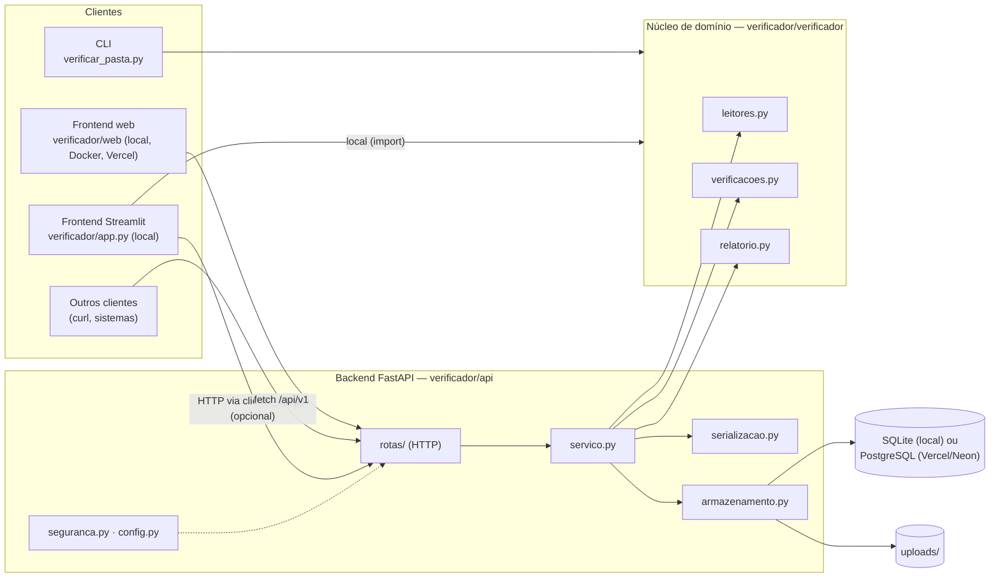
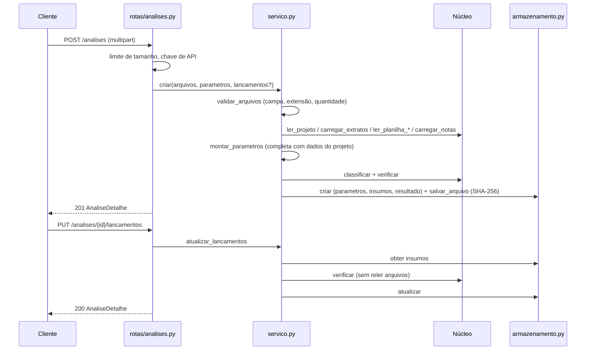
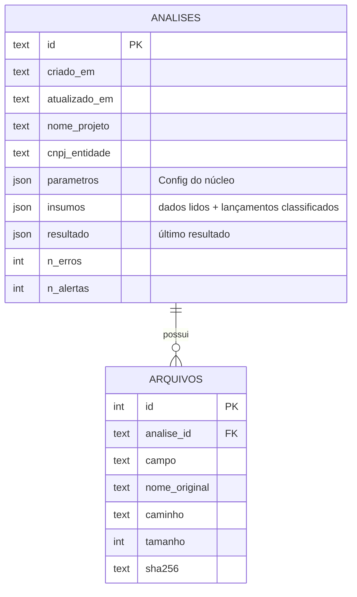

# Arquitetura

## Visão geral

### Camadas

| Camada | Pasta | Regra |
|---|---|---|
| Apresentação | `app.py`, `web/`, `verificar_pasta.py` | Interfaces (Streamlit e web) e CLI. Não contêm regras de negócio. |
| API (adaptador HTTP) | `api/rotas`, `api/esquemas.py`, `api/seguranca.py` | Valida a entrada, converte em chamadas ao serviço e serializa a saída. |
| Aplicação | `api/servico.py` | Casos de uso (criar, revisar, reprocessar, relatório). Não conhece HTTP. |
| Infraestrutura | `api/armazenamento.py`, `api/serializacao.py`, `api/config.py` | SQLite, disco e variáveis de ambiente. |
| Domínio | `verificador/` | Leitura de documentos, regras dos Passos 1–4 e relatório. **Única fonte das regras.** |

## Fluxo de uma análise

## Modelo de dados

**Por que guardar os "insumos" e não só os arquivos?** O frontend permite corrigir a classificação
e os valores dos lançamentos. Guardar os dados já lidos permite recalcular na hora, sem reler PDFs, e
mantém as correções do usuário. Os arquivos originais ficam guardados para auditoria, com hash SHA-256.

## Decisões (ADR resumido)

| # | Decisão | Alternativas consideradas | Motivo |
|---|---|---|---|
| 1 | FastAPI | Flask, Django REST | Validação/OpenAPI automáticos, upload multipart nativo, desempenho. |
| 2 | Backend no mesmo pacote do núcleo | Microsserviço separado | Zero duplicação de regras. Um único deploy. |
| 3 | SQLite (stdlib) no uso local, PostgreSQL na nuvem | ORM (SQLAlchemy) | Sem infraestrutura extra no uso local. Na Vercel o disco é temporário, então `RepositorioPostgres` (mesma interface, SQL quase idêntico) é ativado por `DATABASE_URL`. |
| 4 | Processamento síncrono | Fila (Celery/RQ) | Uma verificação leva segundos. Fila só se surgir lote grande. |
| 5 | Integração opcional no Streamlit | Reescrever o frontend como cliente puro da API | Não quebra o uso local atual (`executar.bat`). |
| 6 | Sem automação de captcha | Serviços de quebra de captcha | Requisito do documento de referência e questão ética/legal. A API gera checklist com links. |
| 7 | Frontend web em HTML/JS puro na Vercel | Next.js/React; Streamlit Community Cloud | A Vercel não roda Streamlit. HTML/JS sem build é servido pela própria API (um único deploy e um único link) e não exige Node.js. |

## Segurança

- Chave de API opcional (`X-API-Key`), comparada em tempo constante.
- Limite de tamanho por arquivo, com leitura limitada a `limite + 1` bytes para não carregar arquivos enormes na memória.
- Lista branca de extensões por campo.
- Nome de arquivo saneado e confinado à pasta da análise (sem *path traversal*).
- SQL sempre parametrizado. Nomes de coluna em `UPDATE` vêm de uma lista branca.
- Contêiner roda como usuário sem privilégios. Só `/app/data` é gravável.
- CORS restrito por padrão a `http://localhost:8501`.
