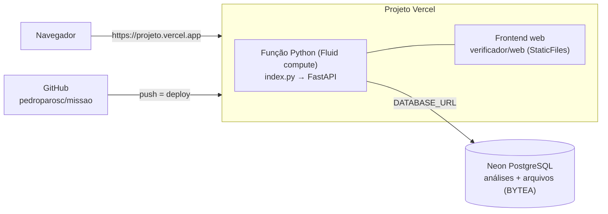

# Deploy na Vercel (frontend web + API + PostgreSQL Neon)

Este guia publica o Verificador em um endereço público como `https://<projeto>.vercel.app`,
com a **interface web**, a **API** e o **histórico salvo em PostgreSQL (Neon, plano gratuito)**.

> O frontend **Streamlit** (`verificador/app.py`) não roda na Vercel, porque precisa de um servidor
> sempre ligado com WebSocket. Na Vercel quem atende o usuário é o **frontend web**
> (`verificador/web/`), que tem as mesmas funções principais. O Streamlit continua disponível
> para uso local (`executar.bat`) e no Docker.

## Como fica na Vercel



| Arquivo | Função no deploy |
|---|---|
| `index.py` (raiz) | Ponto de entrada. Coloca `verificador/` no `sys.path` e exporta `app` (FastAPI). |
| `pyproject.toml` (raiz) | Dependências **só da API e do frontend web** (sem Streamlit), Python 3.12 e `[tool.vercel] entrypoint = "index:app"`. |
| `vercel.json` (raiz) | `maxDuration` de 60 s e exclusão de testes, documentação e backups do pacote da função. |
| `verificador/web/` | Interface web (HTML/CSS/JS), servida na raiz `/`. |
| `verificador/api/config.py` | Detecta a Vercel (`VERCEL=1`) e lê `DATABASE_URL`/`POSTGRES_URL` do Neon. |
| `verificador/api/armazenamento.py` | `RepositorioPostgres`: mesmas operações do SQLite, com arquivos guardados no banco. |

O job **`vercel-simulado`** do CI (`.github/workflows/ci.yml`) reproduz o que a Vercel faz a cada push.
Ele instala só o `pyproject.toml`, confere que o Streamlit ficou de fora, sobe `index:app` com `VERCEL=1`
e um PostgreSQL, e cria uma análise com os arquivos de exemplo.

---

## Passo a passo (painel da Vercel, sem instalar nada)

### 1. Conta
1. Acesse <https://vercel.com/signup> e entre com **Continue with GitHub** (plano **Hobby**, gratuito).
2. Autorize o app da Vercel a acessar o repositório `pedroparosc/missao`. Pode ser só esse repositório.

### 2. Importar o projeto

> **Pré-requisitos que a Vercel cobra antes de importar.** Na primeira vez, ela recusa o vínculo com
> uma destas mensagens. Resolva cada uma assim:
> - *"You need to add a Login Connection to your GitHub account first"*: em **Account Settings →
>   Authentication → Sign-in Methods**, clique em **Connect** na linha **GitHub**.
> - *"To link a GitHub repository, you need to install the GitHub integration first"*: instale o app
>   em <https://github.com/apps/vercel/installations/new>, com **Only select repositories → `pedroparosc/missao`**.
> - *"Multiple applications detected… Services"*: a Vercel encontra duas aplicações FastAPI
>   (`verificador` e `app` em `/`). Clique em **Import single project** na aplicação **`app`**, que fica na raiz `/`.
>
> Se a tela de importação ficar em "Deploying/Loading…" e nenhum deploy aparecer em **Deployments**,
> o projeto já foi criado e conectado ao Git. Basta fazer um push na `main` para disparar o deploy de produção.

1. No painel, clique em **Add New… → Project**.
2. Em **Import Git Repository**, escolha `pedroparosc/missao` e clique em **Import**.
3. Na tela **Configure Project**:
   - **Framework Preset:** `FastAPI`. Se aparecer `Other` ou `Services`, escolha **FastAPI** ou a aplicação `app` em `/`.
   - **Root Directory:** `./` (raiz, não mude).
   - **Build and Output Settings:** deixe o padrão.
   - **Environment Variables:** nenhuma por enquanto.
4. Clique em **Deploy**. O primeiro build leva de 1 a 3 minutos, por causa da instalação do pandas e do pdfplumber.

Ao terminar, abra `https://<projeto>.vercel.app/api/v1/saude`. Sem banco, a resposta mostra
`"banco_tipo":"sqlite","persistente":false`: o sistema funciona, mas o histórico é **temporário**.

### 3. Banco PostgreSQL (Neon, gratuito)
1. No projeto, abra a aba **Storage** e clique em **Create Database** (ou **Browse Marketplace**).
2. Escolha **Neon** (*Serverless Postgres*) e clique em **Continue**.
3. Região: escolha **São Paulo (sa-east-1)**, se houver, ou a mais próxima. Plano: **Free**. Clique em **Continue / Create**.
4. Em **Connect Project**, selecione este projeto e os ambientes **Production** e **Preview** e clique em **Connect**.
   A integração cria sozinha as variáveis `DATABASE_URL`, `POSTGRES_URL` e outras. A aplicação lê
   `DATABASE_URL` primeiro.
5. Abra **Deployments**, clique em **⋯** no último deploy e escolha **Redeploy**. As variáveis novas só valem em deploys novos.

Confira de novo `/api/v1/saude`. O esperado é `"banco_tipo":"postgres","persistente":true`.
As tabelas são criadas automaticamente na primeira requisição.

### 4. Região da função (recomendado)
Em **Settings → Functions → Function Region**, escolha a região mais próxima do banco
(ex.: **São Paulo, Brazil – gru1**) e faça **Redeploy**. Isso reduz a latência entre a função e o Neon.

### 5. Testar
1. Abra `https://<projeto>.vercel.app/`.
2. Clique em **📂 Carregar documentos de exemplo** e depois em **🔎 Verificar prestação de contas**.
3. O resultado esperado com os dados fictícios: **R$ 60.000,00 recebidos da SMF, 4 entradas, 14 erros e 5 alertas**.
4. Na aba **🏦 Lançamentos**, mude a entrada da SMF de 10/06/2026 para *Outra entrada* e clique em
   **Salvar e recalcular**. O resultado passa a ser 13 erros e 6 alertas.
5. Baixe o relatório Word e confira a análise em **Histórico**.

---

## Alternativa: Vercel CLI

Requer Node.js 18 ou superior.

```bash
npm i -g vercel
vercel login
vercel link          # na raiz do repositório
vercel               # deploy de preview
vercel --prod        # deploy de produção
```

O banco Neon pode ser criado pelo painel (passo 3) ou com `vercel integration add neon`.

---

## Ambientes e fluxo de trabalho

| Evento | Resultado na Vercel |
|---|---|
| Push na `main` | Deploy de **produção** (`<projeto>.vercel.app`) |
| Push em outra branch / Pull Request | Deploy de **preview** com URL própria, ótimo para testar antes do merge |
| Variáveis em *Settings → Environment Variables* | Valem a partir do próximo deploy |

> Se o Neon estiver conectado também ao ambiente *Preview*, previews e produção usam o mesmo banco,
> salvo se a integração estiver configurada para criar um *branch* do Neon por preview.

## Variáveis de ambiente

| Variável | Obrigatória? | Valor |
|---|---|---|
| `DATABASE_URL` | Recomendado | Criada pela integração Neon. Sem ela o histórico é temporário. |
| `VERIFICADOR_API_KEY` | Opcional | Exige a chave em todas as rotas da API. Quem usa a interface web informa a chave em *Chave de acesso à API*, no rodapé. Para a apresentação, deixe **sem chave**. |
| `VERIFICADOR_MAX_UPLOAD_MB` | Opcional | Padrão na Vercel: 4 (por arquivo). |
| `VERIFICADOR_CORS_ORIGINS` | Opcional | Só se outro site for chamar a API. |
| `VERCEL` | Automática | Definida pela própria Vercel. Ativa os padrões de nuvem. |

## Limites da Vercel e como o sistema lida com eles

| Limite (plano Hobby) | Valor | Tratamento |
|---|---|---|
| Corpo da requisição | **4,5 MB** por envio | A interface soma o tamanho dos arquivos e bloqueia o envio acima do limite (informado por `/api/v1/parametros`). Os documentos de exemplo somam cerca de 48 KB. |
| Disco | Só `/tmp`, temporário | PostgreSQL (Neon) para análises e arquivos originais. |
| Tamanho do pacote Python | 500 MB | O manifesto da Vercel não inclui o Streamlit. O `vercel.json` exclui testes e documentação. |
| Duração | 60 s (configurado), máximo de 300 s | Uma verificação leva poucos segundos. |
| Partida a frio | Alguns segundos na 1ª requisição | Abra `/api/v1/saude` um pouco antes de demonstrar. |

## Problemas comuns

| Sintoma | Causa provável | Solução |
|---|---|---|
| `"persistente": false` em `/saude` | Neon não conectado, ou conectado sem Redeploy | Repita o passo 3 e faça **Redeploy**. |
| `413 FUNCTION_PAYLOAD_TOO_LARGE` | Arquivos somam mais de 4,5 MB | Envie extratos em XLSX/CSV, que são menores que PDF, ou divida o envio. |
| `500` com "driver PostgreSQL não está instalado" | Dependências instaladas de outro manifesto | Confirme que o `pyproject.toml` está na raiz e contém `psycopg[binary]`. |
| Build falha em "entrypoint" | Root Directory diferente de `./` | Em *Settings → General*, deixe o **Root Directory** vazio ou `./`. |
| Página carrega, mas a API dá 401 | `VERIFICADOR_API_KEY` definida | Informe a chave no rodapé da página ou remova a variável. |

Os logs ficam em **Project → Logs** (filtre por *Function*) e o histórico de builds em **Deployments**.

## Checklist para o dia da apresentação

- [ ] `https://<projeto>.vercel.app/api/v1/saude` mostra `"status":"ok"` e `"persistente":true`.
- [ ] Abrir a página 2 a 3 minutos antes, para "acordar" a função.
- [ ] Testar uma vez o fluxo **Carregar exemplo → Verificar → Lançamentos → Relatório**.
- [ ] Ter o plano B pronto: `executar.bat` local, ou `docker compose up`.
